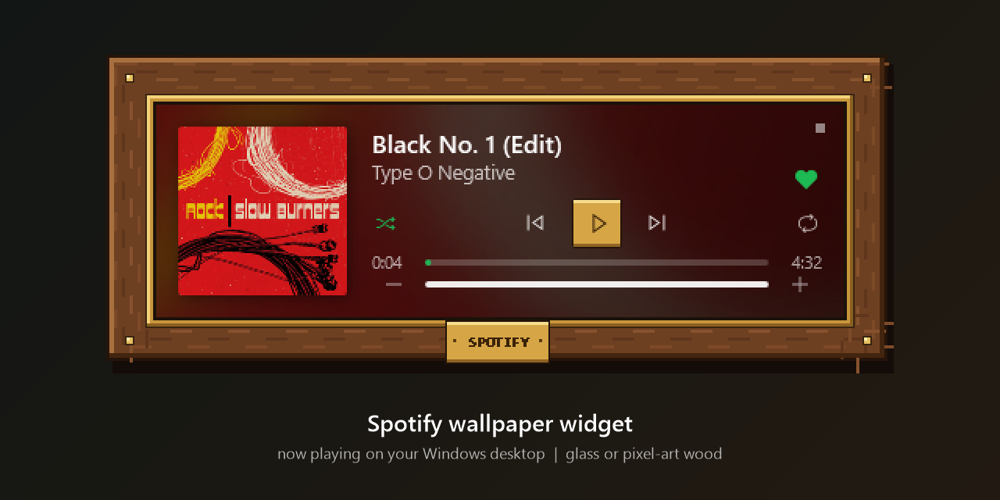
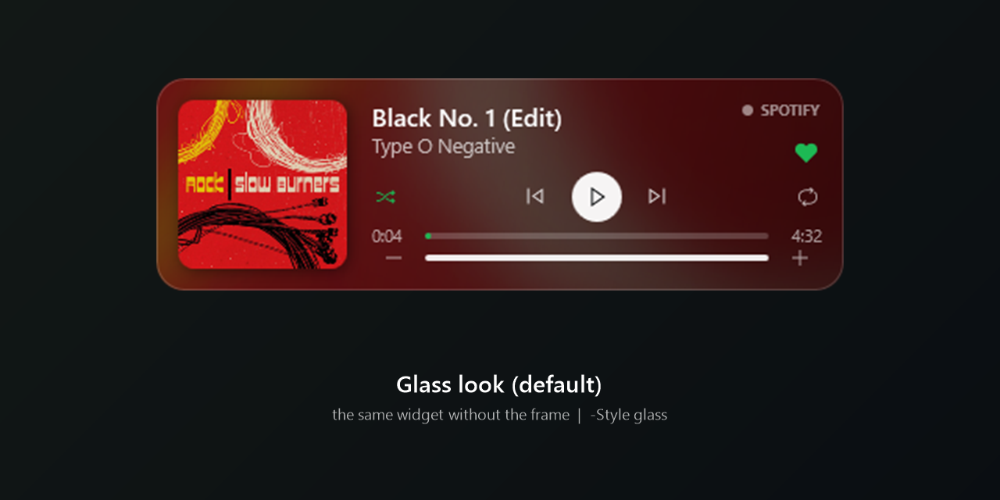

# Віджет Spotify на шпалерах

Картка на робочому столі, під усіма вікнами: обкладинка, назва треку, виконавець, прогрес і кнопки.
Два вигляди: темне скло (за замовчуванням) і піксельна дерев'яна рамка з табличкою «SPOTIFY».

## Встановлення

Потрібно: Windows 10 (версія 1809 або новіша) чи Windows 11 і застосунок Spotify. Права адміністратора не потрібні.

Одним рядком: відкрий PowerShell (Win+X → «Windows PowerShell» або «Термінал») і встав:

```powershell
irm https://raw.githubusercontent.com/twoluu/spotify-wallpaper-widget/main/install.ps1 | iex
```

Або вручну: **Code** → **Download ZIP**, розпакуй архів і двічі клацни `install.cmd`.
Або через git:

```powershell
git clone https://github.com/twoluu/spotify-wallpaper-widget.git
powershell -ExecutionPolicy Bypass -File spotify-wallpaper-widget\install.ps1
```

Інсталятор кладе віджет у `%LOCALAPPDATA%\SpotifyWidget`, додає його в автозапуск Windows і одразу запускає.
Якщо запустити його ще раз, віджет оновиться до останньої версії, а збережене місце на екрані лишиться.
Параметри `install.ps1`: `-Style wood` (дерев'яна рамка замість скла), `-NoAutostart` (без автозапуску),
`-NoStart` (не запускати зараз), `-InstallDir <папка>`. В однорядковому варіанті їх передають так
(наприклад, щоб встановити з дерев'яною рамкою або перемкнути вже встановлений віджет на неї):

```powershell
& ([scriptblock]::Create((irm https://raw.githubusercontent.com/twoluu/spotify-wallpaper-widget/main/install.ps1))) -Style wood
```

Повернути скло — те саме з `-Style glass`. Вибраний вигляд зберігається в `settings.json`.

Видалити (закрити, прибрати з автозапуску й видалити папку):

```powershell
powershell -ExecutionPolicy Bypass -File "$env:LOCALAPPDATA\SpotifyWidget\uninstall.ps1"
```

Якщо монітор один, віджет стає внизу по центру основного монітора. Його видно на робочому столі, під усіма вікнами.

## Як це працює

| Кнопка | Що робить |
|---|---|
| 🔀 | перемішати наступні пісні (зелена, коли увімкнено) |
| ⏮ ⏯ ⏭ | попередній, пауза/грати, наступний; якщо Spotify закритий, ▶ запускає його |
| 🔁 | повтор: вимкнено → весь список → один трек (зелена, коли увімкнено) |
| смуга прогресу | клік — перемотати в це місце |
| − 60% + праворуч | гучність Spotify кроками по 10% (плавно): − і + (можна тримати), клік по смужці лівіше чи правіше її кінця, коліщатко миші над карткою. Число — поточна гучність |

| ♡ праворуч від виконавця | додати пісню, що грає, в «Улюблені треки» Spotify (стає зеленим ♥); ще раз — прибрати |

Гучність і ♡ найкраще працюють зі [Spicetify](https://spicetify.app): розширення `spicetify/widget-volume.js`
з'єднує віджет із самим Spotify — гучність рухає повзунок у Spotify (і навпаки), ♡ працює з «Улюбленими треками».
Якщо Spicetify встановлений, інсталятор додає розширення сам (Spotify один раз перезапуститься; `-NoSpicetify` —
пропустити). Без Spicetify віджет змінює гучність звуку Spotify у Windows, а ♡ сіре.
Після оновлення Spotify, якщо гучність і ♡ перестали працювати: `spicetify backup apply`.

🔀 і 🔁 сірі й не натискаються, поки Spotify закритий.

Якщо другий монітор вимкнений, віджет тимчасово стає на основний і сам повертається, коли монітор знову з'явиться.

- Дані бере з медіа-керування Windows (те саме, що показує спливна панель гучності), тому
  не потрібні ні логін Spotify, ні API-ключ.
- **Перетягни картку мишею**, щоб перемістити. Місце зберігається в `settings.json`.
- **Клік по обкладинці** відкриває Spotify. Якщо Spotify закритий, ▶ запускає його і пробує одразу ввімкнути музику.
  Щойно запущений Spotify часто ще не має вибраної пісні, і тоді Windows не може її ввімкнути: віджет пише
  «Обери пісню в Spotify», а ▶ відкриває вікно Spotify. Після першої пісні всі кнопки працюють з віджета.
- Фокус не забирає, у панелі задач і Alt+Tab не з'являється.
- Запускається разом з Windows (ярлик `Spotify Widget` у папці «Автозавантаження»).

## Команди

Папка віджета: `%LOCALAPPDATA%\SpotifyWidget` після встановлення (на комп'ютері, де його створено, — `E:\code\spotify-widget`).

```powershell
# запустити
powershell -ExecutionPolicy Bypass -File "$env:LOCALAPPDATA\SpotifyWidget\start-spotify-widget.ps1"
# закрити
powershell -ExecutionPolicy Bypass -File "$env:LOCALAPPDATA\SpotifyWidget\stop-spotify-widget.ps1"
# повернути на початкове місце (центр низу другого монітора)
powershell -ExecutionPolicy Bypass -WindowStyle Hidden -File "$env:LOCALAPPDATA\SpotifyWidget\spotify-widget.ps1" -Reset
```

Інші параметри `spotify-widget.ps1`: `-Style glass|wood` (вигляд; запам'ятовується), `-Monitor primary` (на основний монітор),
`-BottomMargin 50` (відступ від низу), `-Source chrome` (показувати YouTube у Chrome замість Spotify).

Помилки пишуться в `widget.log` у папці віджета. Прибрати лише автозапуск: `uninstall.ps1 -KeepFiles` або видалити
`%APPDATA%\Microsoft\Windows\Start Menu\Programs\Startup\Spotify Widget.lnk`.

## English


A Spotify "now playing" card for the Windows desktop (it sits on the wallpaper, under all windows): cover, title,
artist, progress bar (click to seek) and shuffle / previous / play-pause / next / repeat. Two looks: dark glass
(default) or a pixel-art wooden frame (`-Style wood`). ▶ starts Spotify when it is closed.
It reads Windows' own media controls, so it needs no Spotify login or API key. Windows 10 1809+ or 11.

Install, in PowerShell:

```powershell
irm https://raw.githubusercontent.com/twoluu/spotify-wallpaper-widget/main/install.ps1 | iex
```

or download the ZIP (Code → Download ZIP), unpack it and double-click `install.cmd`. It goes to
`%LOCALAPPDATA%\SpotifyWidget` and starts with Windows; run the same line again to update. For the wooden frame:
`& ([scriptblock]::Create((irm https://raw.githubusercontent.com/twoluu/spotify-wallpaper-widget/main/install.ps1))) -Style wood`.
Remove it with `powershell -ExecutionPolicy Bypass -File "$env:LOCALAPPDATA\SpotifyWidget\uninstall.ps1"`.
